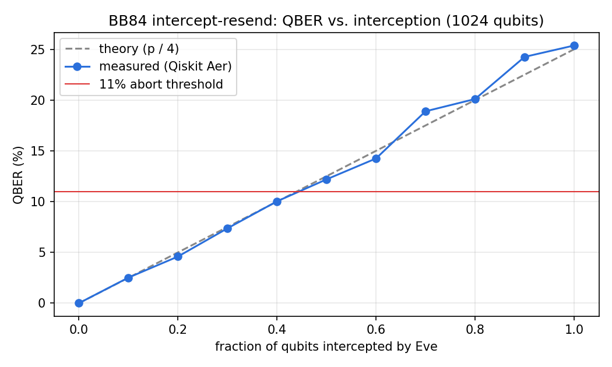

# BB84 Quantum Key Distribution Simulator

A simulation of the **BB84 quantum key distribution protocol**, built in two layers:

- **Quantum channel**: Qiskit (Aer simulator). Alice encodes random bits in random bases (Z / X), and Bob measures in his own random bases. An optional **intercept-resend eavesdropper** (Eve) measures and re-sends qubits.
- **Classical channel**: a real **TCP socket** (Alice = server, Bob = client) carrying basis reconciliation, QBER estimation and the abort decision. The sifted key then **AES-256-GCM** encrypts messages between the two endpoints.

The classical channel is captured in **Wireshark** to verify what an eavesdropper on the wire can learn: bases and sacrificed sample bits, but **0 bits of the final key**.



## Results (1,024 qubits, 20 trials each)

| Scenario | Sift rate | Mean QBER | Aborted |
|---|---|---|---|
| No eavesdropper | 49.9% | 0.00% | 0 / 20 |
| Intercept-resend (100%) | 50.1% | 25.02% (σ 1.99%) | 20 / 20 |

- About half of the qubits survive sifting (~512 of 1,024). 25% of those are publicly compared to estimate the QBER and then discarded. The remaining ~385 bits go through HKDF-SHA256 to become the AES-256 key.
- Eve's measured QBER follows the theoretical **p / 4** curve, where p is the fraction of qubits she intercepts. The protocol aborts once the QBER exceeds the **11%** security threshold, which happens when Eve intercepts roughly 45% or more of the qubits.

## How it works

```
 Alice                                   Bob
   |  ~~~~ 1024 qubits (Qiskit) ~~~~>     |      quantum channel (Eve may intercept-resend)
   |                                      |
   |  <------ hello -------------------   |  \
   |  ------- bases (Alice) ---------->   |   |
   |  <------ bases (Bob) -------------   |   |  classical channel
   |  ------- sample indices --------->   |   |  TCP 127.0.0.1:9000
   |  <------ sample bits -------------   |   |  newline-delimited JSON
   |  ------- verdict (QBER, accept) -->  |   |  (captured in Wireshark)
   |  ------- AES-256-GCM ciphertext -->  |   |
   |  <------ AES-256-GCM ciphertext --   |  /
```

| Basis | bit 0 | bit 1 |
|---|---|---|
| Z (rectilinear) | \|0⟩ | \|1⟩ |
| X (diagonal) | \|+⟩ | \|−⟩ |

**Why Eve gets caught:** when she guesses the wrong basis (50% of the time), she collapses the qubit into the wrong basis. Bob then reads a random result (wrong 50% of the time), so 0.5 × 0.5 = **25%** of the sifted bits are wrong.

## Run it

```bash
python3 -m venv .venv && source .venv/bin/activate
pip install -r requirements.txt

python run_demo.py              # clean channel: key accepted, message encrypted
python run_demo.py --eve        # eavesdropper: QBER ~25%, aborted
python run_demo.py --eve --intercept 0.3   # partial attack: QBER ~7.5%, slips under the threshold
python verify_leakage.py        # what did the wire reveal?
python experiments.py           # statistics + chart
pytest -q                       # 6 tests, including end-to-end over TCP
```

## Wireshark capture of the classical channel

Two captures are included in [`captures/`](captures), both taken on loopback (`lo0`) with the capture filter `tcp port 9000`:

| File | Run | Packets | Messages on the wire | Outcome |
|---|---|---|---|---|
| `bb84_clean.pcapng` | no eavesdropper | 24 | hello, bases ×2, sample, sample_bits, verdict, data ×2 | QBER 0.00%, 372-bit key, AES-256-GCM messages exchanged |
| `bb84_eve.pcapng` | intercept-resend Eve | 20 | hello, bases ×2, sample, sample_bits, verdict | QBER 27.13%, **aborted**: no data ever sent |

In both captures, `verify_leakage.py` reports **0 key bits leaked on the wire**. Each capture shows the TCP 3-way handshake (SYN, SYN-ACK, ACK), the JSON messages as PSH/ACK segments, and the FIN teardown.

To reproduce:

1. Open Wireshark, select the **Loopback: lo0** interface and set the capture filter to `tcp port 9000`.
2. Start the capture, then run `python run_demo.py` (and once more with `--eve`).
3. Stop the capture and save it as `captures/bb84_clean.pcapng`.
4. Right-click any packet, choose **Follow → TCP Stream**, and read the full JSON conversation.
5. Verify from the capture itself:
   ```bash
   python verify_leakage.py --pcap captures/bb84_clean.pcapng
   ```

Useful display filters:

| Filter | Shows |
|---|---|
| `tcp.port == 9000` | the whole BB84 session |
| `tcp.flags.syn == 1 && tcp.port == 9000` | the TCP 3-way handshake |
| `tcp.port == 9000 && tcp.len > 0` | only segments carrying data |
| `frame contains "verdict"` | the QBER / accept / abort decision |
| `frame contains "ciphertext"` | the encrypted AES-GCM payloads |

## Project layout

```
bb84/quantum.py    Qiskit circuits: Alice's preparation, Eve's intercept-resend, Bob's measurement
bb84/protocol.py   sifting, QBER, HKDF key derivation, AES-256-GCM
bb84/channel.py    JSON-over-TCP framing with a transcript of everything sent and received
bb84/parties.py    Alice (server) and Bob (client) state machines
run_demo.py        end-to-end demo
verify_leakage.py  checks the transcript or pcap for leaked key bits
experiments.py     QBER statistics and chart
```

## Simplifications (on purpose)

- **No error-correction step (Cascade).** With a noiseless channel and no Eve, Alice's and Bob's keys already match. HKDF stands in for privacy amplification.
- **The classical channel is not authenticated here.** Real BB84 requires an authenticated classical channel, otherwise a man-in-the-middle can impersonate Alice to Bob and vice versa. A production system would use pre-shared-key MACs or post-quantum signatures (ML-DSA).
- **Quantum and classical layers run in one demo process.** The simulated quantum channel runs inside the demo script. Alice and Bob each receive only their own private data and then talk over a real socket.
